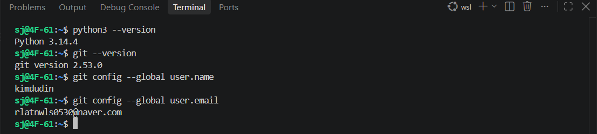
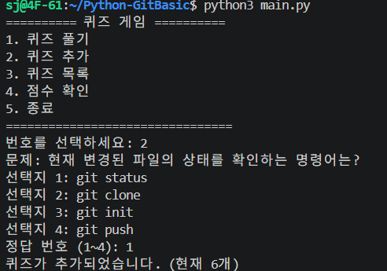
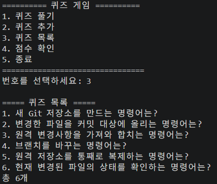
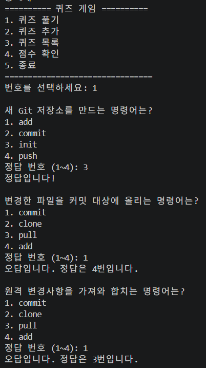
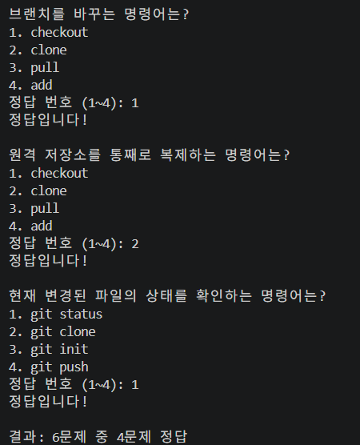
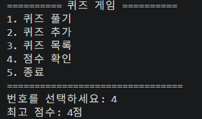
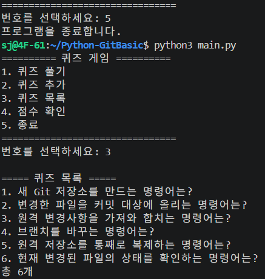
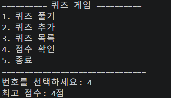
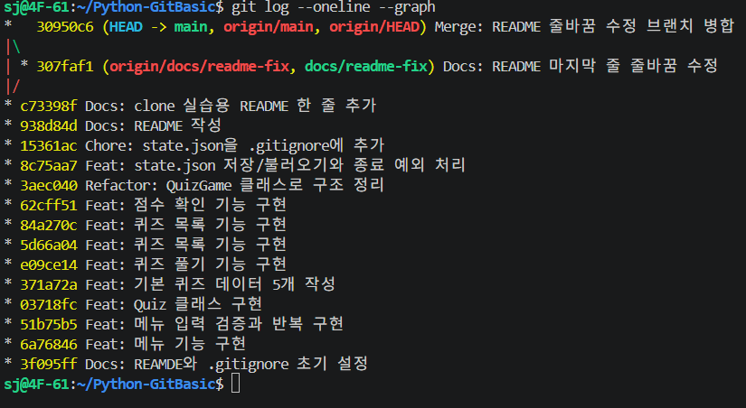
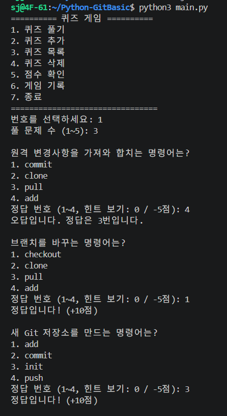

# Python-GitBasic: 터미널 퀴즈 게임

## 1. 프로젝트 개요

Python으로 만든 콘솔 퀴즈 게임입니다. 메뉴에서 번호를 골라 퀴즈를 풀고, 새 퀴즈를 추가하고, 목록과 최고 점수를 확인할 수 있습니다. 퀴즈와 최고 점수는 `state.json`에 저장되어 프로그램을 종료하고 다시 실행해도 유지됩니다. 클래스(객체 지향), 파일 입출력(JSON), 예외 처리, Git 워크플로우를 연습하기 위한 프로젝트입니다.

객체지향(OOP) 사용 이유: Quiz 클래스로 데이터를 구조화하고 QuizGame 클래스로 로직을 캡슐화하여, 기능 확장(예: 새로운 게임 모드 추가) 시 코드 수정 범위를 최소화할 수 있습니다.
JSON 채택 이유: 파이썬 딕셔너리와 구조가 동일하여 변환이 쉽고, 텍스트 기반이라 데이터 확인 및 디버깅이 용이합니다.


## 2. 퀴즈 주제와 선정 이유

- **주제:** Git 기초 명령어 (init, add, commit, push, pull, checkout, clone)
- **선정 이유:** 이번 미션에서 직접 사용하는 명령어들이라, 퀴즈로 만들어 각 명령어의 역할을 복습하고 시험 예상문제로도 나올 수 있을 것 같아 선택했습니다.

## 3. 실행 방법

요구 사항: Python 3.10 이상 (기본 퀴즈 수 : 5개 자동 생성)

```bash
git clone https://github.com/kimdudin/Python-GitBasic.git
cd Python-GitBasic
python3 main.py
```

## 4. 기능 목록

| 메뉴 | 기능 | 설명 | 저장 시점 |
|---|---|---|---|
| 1 | 퀴즈 풀기 | 문제 수 선택, 랜덤 출제, 힌트(-5점), 100점 만점 환산, 최고 점수 갱신 | 게임 종료 시 |
| 2 | 퀴즈 추가 | 문제, 선택지 4개, 정답 번호, 힌트(선택) 입력 후 저장 | 추가 완료 시 |
| 3 | 퀴즈 목록 | 등록된 퀴즈를 번호와 함께 출력 | - |
| 4 | 퀴즈 삭제 | 번호를 골라 삭제 후 저장 | 삭제 완료 시 |
| 5 | 점수 확인 | 최고 점수 확인 (풀지 않았으면 안내) | - |
| 6 | 게임 기록 | 최근 10판의 날짜/시간, 문제 수, 점수 확인 | - |
| 7 | 종료 | 프로그램 안전 종료 | 종료 직전 |


입력 검증 및 예외 사례 (평가 보완)
잘못된 메뉴 선택: 숫자 이외 입력 시 "숫자만 입력해주세요", 범위 밖 입력 시 "1~7 사이를 입력하세요" 안내 후 재입력.
퀴즈 추가 중단: 문제 입력 중 Ctrl+C 발생 시, 현재 추가 중인 내용은 무시(Rollback)하고 안전하게 메인 메뉴로 복귀합니다.
데이터 로드 실패: state.json이 손상된 경우, 에러 메시지 출력 후 기본 퀴즈 세트로 자동 복구하여 실행을 보장합니다.


공통 처리:
- 입력 앞뒤 공백 제거, 빈 입력, 숫자 아님, 범위 밖 입력 시 안내 후 재입력
- Ctrl+C, 입력 종료(EOF) 시 안내 메시지를 출력하고 저장 후 안전하게 종료
- `state.json`이 없으면 기본 퀴즈 사용, 손상되면 안내 후 기본값으로 복구


## 실행 화면

### 개발 환경


### 퀴즈 추가


### 퀴즈 목록


### 퀴즈 풀기



### 점수 확인


### 재실행 후 데이터 유지



### Git 이력 -총 18개



### 보너스게임

#### 1. 랜덤 출제 및 문제 수 선택


#### 2. 힌트 기능


#### 3. 퀴즈 삭제 기능


#### 4. 점수 기록 히스토리


## 5. 파일 구조

```text
Python-GitBasic/
├── main.py                 # 메인 실행 파일 (퀴즈 로직)
├── README.md               # 프로젝트 설명서
├── .gitignore              # Git 추적 제외 설정
├── state.json              # 실행 시 생성되는 데이터 파일 (퀴즈/점수/기록 저장, Git 추적 제외)
└── docs/
    └── screenshots/        # 실행 화면 스크린샷 폴더
        ├── dev_env.png              # 개발 환경 (VS Code)
        ├── add_quiz.png             # 퀴즈 추가 화면
        ├── quiz_list.png            # 퀴즈 목록 확인
        ├── play1.png                # 퀴즈 풀이 화면 1
        ├── play2.png                # 퀴즈 풀이 화면 2
        ├── score.png                # 최종 점수 화면
        ├── quiz_after_restart.png   # 재시작 후 퀴즈 유지 확인
        ├── score_after_restart.png  # 재시작 후 점수 유지 확인
        ├── git_log.png              # Git 커밋 히스토리
        ├── bonus.png                # [보너스] 랜덤 출제 및 문제 수 선택
        ├── hint.png                 # [보너스] 힌트 보기 기능
        ├── remove.png               # [보너스] 퀴즈 삭제 기능
        └── history.png              # [보너스] 역대 점수 기록 확인
```

주요 클래스:
- `Quiz`: 퀴즈 한 문제 (question, choices, answer, hint), 출력/정답 확인/딕셔너리 변환
- `QuizGame`: 게임 전체 관리 (퀴즈 목록, 최고 점수, 게임 기록, 메뉴, 저장/불러오기)

## 6. 데이터 파일 (state.json)

- **경로:** 프로젝트 루트의 `state.json` (UTF-8)
- **역할:** 퀴즈 목록, 최고 점수, 게임 기록을 저장해 종료 후에도 유지
- **생성:** 퀴즈 추가/삭제, 퀴즈 풀기, 종료 시 자동 생성/갱신
- **스키마:**

```json
{
  "quizzes": [
    {
      "question": "새 Git 저장소를 만드는 명령어는?",
      "choices": ["add", "commit", "init", "push"],
      "answer": 3,
      "hint": "'시작하다'라는 뜻의 영어 단어와 관련 있어요."
    }
  ],
  "best_score": 80,
  "history": [
    {
      "played_at": "2026-11-12 15:30:00",
      "total": 5,
      "correct": 4,
      "hints_used": 1,
      "score": 80
    }
  ]
}
```

- `quizzes`: 퀴즈 배열 (`answer`는 1~4, `hint`는 없으면 빈 문자열)
- `best_score`: 최고 점수, 100점 만점 (아직 풀지 않았으면 `null`)
- `history`: 게임 기록 배열 (시각, 푼 문제 수, 정답 수, 힌트 사용 횟수, 점수)

## 7. 기술적 상세 설명
데이터 로드 흐름 (load_state)
파일 존재 확인 → 2. JSON 파싱 → 3. 데이터 유효성 검사 → 4. 실패 시 기본값(Default) 생성 및 복구.
책임 분리 (Separation of Concerns)
입력 검증: get_number_input 함수가 전담하여 데이터의 무결성을 확보합니다.
데이터 I/O: save_state, load_state가 전담하여 로직과 저장소 간 의존성을 낮췄습니다.
JSON 저장 방식의 한계 및 대안
한계: 데이터가 수만 건 이상으로 커질 경우 파일 전체를 읽어야 하므로 메모리 효율이 떨어집니다.
대안: 향후 대용량 데이터 처리가 필요할 경우 SQLite와 같은 RDBMS 도입이 필요합니다.

## 8. Git 워크플로우 전략
커밋 규칙 및 메시지 템플릿
Feat: 새로운 기능 추가
Fix: 버그 수정
Docs: 문서 수정 (README 등)
Refactor: 코드 구조 개선
브랜치 전략
main: 최종 배포용 안정 브랜치
feature/기능명: 각 기능(퀴즈, 기록 등) 개발을 위한 독립 브랜치 사용 후 Merge 수행.
### clone/pull 실습 기록
1. 별도 폴더에 저장소를 `git clone`으로 복제
2. 복제본에서 README를 수정하고 `commit` → `push`
3. 원래 작업 폴더에서 `git pull`로 변경사항을 가져와 반영 확인

- 관련 커밋: `Docs: clone 실습용 README 한 줄 추가`
- 사용한 Git 명령어: init, add, commit, push, pull, checkout, clone (7종 모두 사용)


## 9. 유지보수 가이드 (변경 포인트)
퀴즈 속성 추가 시: Quiz 클래스의 __init__과 to_dict 메서드 수정 필요.
저장 방식 변경 시: QuizGame의 save_state와 load_state 메서드 수정 필요.
메뉴 확장 시: QuizGame.run 메서드의 메뉴 출력 및 조건문 수정 필요.